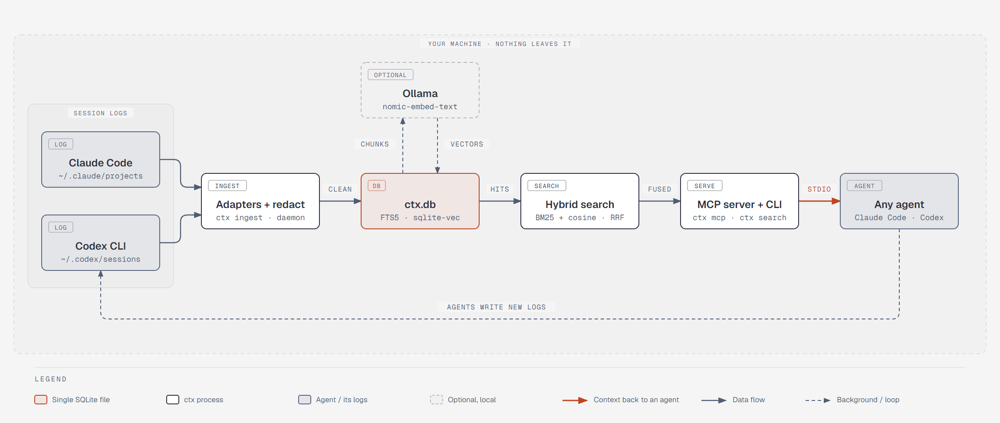

<div align="center">

# kaectx

### One local memory for every coding agent on your machine.

**Claude Code and Codex can search each other's past sessions. Nothing leaves the machine it runs on.**

[](https://github.com/danPoku/kaectx/releases/latest)
[](https://github.com/danPoku/kaectx/actions/workflows/test.yml)
[](go.mod)
[](#tools)
[](#install)
[](LICENSE)

[Quick start](#quick-start) · [How it works](#how-it-works) · [Remote development](#remote-and-cloud-development) · [MCP tools](#tools) · [Commands](#commands) · [Privacy](#privacy) · [Limitations](#limitations) · [Contributing](CONTRIBUTING.md)

```
curl -fsSL https://raw.githubusercontent.com/danPoku/kaectx/master/install.sh | sh
```

<sub>The command is <code>kae</code>. It was <code>ctx</code> up to v0.2.0; see <a href="#upgrading-from-ctx">Upgrading from ctx</a>.</sub>

</div>

kaectx keeps one searchable copy of your coding-agent conversations, and lets any
agent search it.

I use Claude Code and Codex on the same projects. Each one writes its own
session logs, in its own format, and neither can see what the other worked out
yesterday. Neither is good at searching its own history either. kaectx reads the
logs those tools already write, puts them in a single SQLite file, and answers
queries from a command line and from an MCP server, so an agent can ask "have
we dealt with this before?" and get an answer from any agent's past sessions.

It is a single Go binary. Everything stays on your machine.

<picture>
  <source media="(prefers-color-scheme: dark)" srcset="docs/diagrams/architecture-dark.png">
  
</picture>

```
$ kae search "how does the daemon embed new chunks in the background"
[claude-code] 2026-09-20T16:11:47.479Z  claude-code:91ae043d-130e-4d25-8db5-266fe79bbbd5
    User: run the embed worker from the daemon  Assistant: Tests pass, inc…
```

## Status

Early. The current tagged release is v0.2.0, which adds file-aware memory,
retrieval outcome tracking, opt-in risk-aware search, checkpoint and feedback
signals, `kae doctor` and `kae audit-secrets`. Linux (including Ubuntu under WSL2) is the
primary environment; native Windows and macOS are also supported and tested. Expect
breaking changes in the 0.x series, including to the database schema and the
MCP tool output. See
[Limitations](#limitations) before relying on it.

Articles written before v0.2.0 describe the v0.1.3 feature set. They are still
useful as snapshots of the original local-search release; pin `@v0.1.3` if you
want exactly what those articles show.

## What it does

- Reads Claude Code and Codex CLI session logs and stores them in
  `~/.kae/kae.db`.
- Splits each session into retrieval units: one user turn plus the assistant's
  reply, with tool noise trimmed.
- Searches them by keyword (SQLite FTS5) and, if you run a local embedding
  model, by meaning too. The two rankings are combined with reciprocal rank
  fusion.
- Groups sessions into projects by the normalised git remote of their working
  directory, so the same repository checked out in two places is one project.
- Records the git commit range a session ran against, resolved from the log's
  own timestamps, when its working directory is a git checkout.
- Explains a file from memory: which sessions touched it, what actions they
  took, and where to open the relevant exchange.
- Serves the history over MCP, so Claude Code, Codex, or any MCP client can
  search it, page through a session, and save notes.
- Redacts API keys and similar secrets before anything is written to disk,
  and can re-scan the stored history for anything the rules would now catch.
- Records which search results agents opened and whether they helped, and can
  use those outcomes to rerank later searches (opt-in).
- Tells agents when a session has grown long enough to warrant a handoff.
- Can run as a daemon that ingests sessions as they are written.

## Requirements

- Nothing, for a prebuilt binary: Linux (x86-64 or arm64), macOS (Apple Silicon
  or Intel) or Windows (x86-64).
- To build from source: Go 1.27 or newer, a C compiler (the SQLite driver and
  the vendored sqlite-vec extension are built with cgo) and the `sqlite_fts5`
  build tag. Every build and test command below includes it.
- Optional, for semantic search: [Ollama](https://ollama.com) with the
  `nomic-embed-text` model. Without it kae falls back to keyword search and
  says so.

## Install

Linux and macOS:

```
curl -fsSL https://raw.githubusercontent.com/danPoku/kaectx/master/install.sh | sh
```

Windows (PowerShell):

```powershell
irm https://raw.githubusercontent.com/danPoku/kaectx/master/install.ps1 | iex
```

Each script downloads the archive for your machine from the
[latest release](https://github.com/danPoku/kaectx/releases/latest), checks it
against the release's `SHA256SUMS`, and refuses to install on a mismatch. On
Linux and macOS `kae` goes into `~/.local/bin`; on Windows into
`%LOCALAPPDATA%\Programs\kae`, which is added to your user `PATH`. Set
`KAE_INSTALL_DIR` to choose another folder, and `KAE_VERSION` (for example
`v0.3.0`) to install a particular release. Run the script again to upgrade.
`kae version` shows what is installed.

### Package managers

| | Install | Upgrade |
| --- | --- | --- |
| Homebrew (macOS, Linux) | `brew install danPoku/tap/kae` | `brew upgrade kae` |
| Scoop (Windows) | `scoop bucket add danPoku https://github.com/danPoku/homebrew-tap` then `scoop install kae` | `scoop update kae` |
| winget (Windows) | `winget install danPoku.kae` | `winget upgrade danPoku.kae` |

All three install the same prebuilt binary as the scripts above, checked
against the same checksums, and are updated by the release workflow on each
release. A new version reaches winget once its pull request to
`microsoft/winget-pkgs` is merged, which can take a day or two.

### Manual download

The archives can also be downloaded by hand from the release page:
`kae_linux_amd64.tar.gz`, `kae_linux_arm64.tar.gz`, `kae_darwin_arm64.tar.gz`,
`kae_darwin_amd64.tar.gz` and `kae_windows_amd64.zip`. The binaries are not
code-signed. On macOS, a binary downloaded with a browser is quarantined;
clear that with `xattr -d com.apple.quarantine kae`, or use the script, which
is not affected. The first release with prebuilt binaries is the one after
v0.2.0; for v0.2.0 and earlier, build from source.

### From source

```
go install -tags sqlite_fts5 github.com/danPoku/kaectx/cmd/kae@latest
```

`@latest` follows the newest tagged release. To pin one, use a version such as
`@v0.3.0`. Running `go version -m "$(command -v kae)"` shows which version you
have installed. Releases up to v0.2.0 have no `cmd/kae`; their command is
`cmd/ctx`.

The repository and Go module are `kaectx`; only the command is `kae`. The module
was renamed from `ctx` to `kaectx` in v0.1.3, so the old path
`github.com/danPoku/ctx` only resolves up to v0.1.2.

Or from a clone:

```
git clone https://github.com/danPoku/kaectx
cd kaectx
go install -tags sqlite_fts5 ./cmd/kae
```

Either puts `kae` in `$(go env GOPATH)/bin`. Make sure that directory is on your
`PATH`.

### Upgrading from ctx

Up to v0.2.0 the command, the data folder and the MCP server were all called
`ctx`. They are now `kae`:

| | Before | Now |
| --- | --- | --- |
| Command | `ctx` | `kae` |
| Data | `~/.ctx/ctx.db` | `~/.kae/kae.db` |
| MCP server (and tool prefix) | `ctx` (`mcp__ctx__*`) | `kae` (`mcp__kae__*`) |
| systemd unit | `ctx-daemon.service` | `kae-daemon.service` |

To move over:

1. Install both commands, so that the old name keeps working while you switch:

   ```
   go install -tags sqlite_fts5 github.com/danPoku/kaectx/cmd/kae@latest github.com/danPoku/kaectx/cmd/ctx@latest
   ```

   `ctx` is now a deprecated alias: it runs the same code as `kae` and prints a
   notice on stderr. It will be removed in the next minor release.
2. Close your agents and stop the daemon, then run any command, for example
   `kae doctor`. The first run moves `~/.ctx` to `~/.kae` and renames the
   database. Nothing is re-ingested. A `MOVED-TO-KAE.txt` note is left in
   `~/.ctx` saying where the data went.

   The move is refused while another process still has the old database open
   (a daemon, or an agent's MCP server). kae then says so, keeps using
   `~/.ctx` for that run, and tries again on the next one.
3. Run `kae migrate-agents` (add `--dry-run` to see the changes first). It
   replaces the `ctx` MCP registration with a `kae` one in Claude Code,
   through `claude mcp`, and in Codex's `~/.codex/config.toml`, keeping a copy
   as `config.toml.kae-backup`. It is safe to run twice.
4. Update anything that names the old tools: permission allowlists and
   `CLAUDE.md` or `AGENTS.md` instructions that say `mcp__ctx__...` now need
   `mcp__kae__...`. `kae migrate-agents` lists the Claude Code settings files
   that still mention them, and does not edit them.
5. If you run the daemon as a service, rename the unit and point it at `kae`
   (see [Running it continuously](#running-it-continuously)).

### Windows, from source

Building on Windows needs cgo and a MinGW-w64 compiler for SQLite and
sqlite-vec. From a clone, the checked-in installer discovers an MSYS2
UCRT64 or MinGW64 compiler, optionally runs the native test gate, creates a
timestamped backup of the existing executables, and installs `kae.exe` and the
deprecated `ctx.exe` alias into the Go bin directory:

```powershell
winget install MSYS2.MSYS2
C:\msys64\usr\bin\bash.exe -lc "pacman -S --needed --noconfirm mingw-w64-ucrt-x86_64-gcc"

git clone https://github.com/danPoku/kaectx
cd kaectx
.\scripts\install-windows.ps1 -RunTests
```

If an agent already has `kae mcp` (or the old `ctx mcp`) open, close that
session first or add `-StopRunning`; Windows does not replace a running
executable. Native
Windows stores its catalogue at `%USERPROFILE%\.kae\kae.db` and reads the
Windows-native Claude Code and Codex logs. It is independent of a WSL
installation and its `/home/<user>/.kae/kae.db`.

### macOS

macOS is supported: every pull request is built and tested on Apple Silicon
(`macos-latest`). The install script above needs nothing else. Building from
source needs Apple's command-line compiler tools for cgo:

```
xcode-select --install
go install -tags sqlite_fts5 github.com/danPoku/kaectx/cmd/kae@latest
```

Session logs are read from `~/.claude/projects` and `~/.codex/sessions`, and the
database is `~/.kae/kae.db`, as on Linux.

For semantic search:

```
brew install ollama
ollama pull nomic-embed-text
kae embed
```

Intel Macs are not part of CI. Nothing in the code is specific to either
architecture, but if you run kae on one, an issue with the result, good or
bad, is welcome.

## Quick start

```
kae setup                         # connects your agents, ingests their history, offers a background service
kae search "refresh token race"   # searches the project you are standing in
```

`kae setup` finds Claude Code and Codex on the machine, registers kae's MCP
server with each, creates the database, reads the session logs the agents
have already written, and offers to run the daemon as a background service.
It asks before the two optional changes (Codex's approval mode, and the
service), and it is safe to run again: a second run changes nothing and says
so. `--dry-run` prints every change without making any, `--yes` answers yes
to the questions, and `--no-daemon` skips the service. See
[Connecting agents](#connecting-agents) for exactly what it changes.

The first ingest into an empty database, from `kae setup` or `kae ingest`,
ends with a summary of what kae found, because that history existed before
you installed it:

```
kae found 412 sessions across 9 projects, from 2026-02-03 to 2026-11-23.
This history was already on your disk: kae read the logs your agents had written.

By agent:
  claude-code  301 sessions
  codex        111 sessions

Secrets redacted before storing: 57

Try:

  kae search "refresh token race"
```

The suggested search is built from the title of the most recent session in the
project you are standing in, and is only shown with the result it returns.
Later ingests print one line. `kae ingest --quiet` leaves the summary out.

The same steps by hand:

```
kae init                          # creates ~/.kae and the database
kae ingest                        # reads ~/.claude/projects and ~/.codex/sessions
ollama pull nomic-embed-text      # optional, enables semantic search
kae embed                         # embeds chunks that don't have vectors yet
kae search "refresh token race"   # searches the project you are standing in
kae explain internal/auth.go      # shows past sessions that touched a file
```

`kae search` is scoped to the project that contains your current directory;
`--all-projects` searches every project and names each hit's project, for work
that spans repos (an API and its frontend, say). Use
`--agent claude-code` or `--agent codex` to restrict results to one agent,
`--limit N` to change how many come back, and `--since`/`--until` to search one
period (`--since 2026-09-28 --until 2026-10-04`; a date as `--until` includes
that whole day, dates are UTC). Equally good matches are listed newest first.
If some session logs haven't been ingested yet, it says so on stderr.

After upgrading from an older version, run these once (add `--dry-run` to see
what they would do first). Each is safe to repeat and runs in a single
transaction. `messages`, `projects` and `notes` read only what is already in the
database; `touches` and `git` also read the sessions' git repositories:

- `kae repair touches` rebuilds file records for Codex `apply_patch` calls
  ingested before kae could read them, from the patch text already stored.
- `kae repair messages` re-reads user messages from their stored raw lines.
  Older versions filed harness-injected text (task notifications, IDE context,
  Codex environment snapshots, AGENTS.md) as if the person had typed it, kept
  only the first block of a multi-part prompt, and left Codex sessions
  untitled. This reclassifies those messages, rebuilds the affected sessions'
  chunks (re-embedded by `kae daemon` or `kae embed`), and titles sessions
  from their first typed prompt.
- `kae repair git` recomputes each session's git commit span from its own
  timestamps and rewrites older working-directory-relative file paths to be
  repo-root-relative. Rows whose directory no longer exists are retried on the
  next run.
- `kae repair notes` links each saved note to the exchange it was saved in,
  by finding its `save_note` call in the messages already stored. Notes saved
  from now on are linked when their session is ingested; this fills the link
  for notes saved before. A call is matched on the note's ID and its title, so
  a log from another machine cannot claim a note here. Only Claude Code logs
  are read: Codex calls MCP tools through a script, and no Codex log with a
  `save_note` call existed to read the shape from.
- `kae repair projects` re-files Claude Code sessions under the project their
  main transcript starts in. Older versions let a subagent transcript, which
  reuses its parent's session id, choose the project, so a session could land
  in a parent folder's project and vanish from its repo's search. It also sets
  each session's start to its earliest message, lists every session it moves,
  and never creates a project: a session whose first folder no known project
  owns is left as it is. Other agents' sessions are re-filed by the folder
  they logged, which merges one folder that older versions split by spelling
  (`C:\x` and `/mnt/c/x`) and moves git worktree sessions to their repo.

`kae explain <path>` is also project-scoped. The path is project-relative, such
as `internal/store/store.go`.

## Running it continuously

`kae daemon` watches both session directories, ingests changes as they happen,
does a full rescan every five minutes in case a filesystem event was missed,
and embeds new chunks every 30 seconds if Ollama is reachable. If Ollama is
down it logs the error once and keeps ingesting.

Without the daemon, `kae mcp` closes most of the gap itself: it catches up on
unread logs in the background when an agent starts it, and again when a search
finds logs it hasn't read. `search_context` and `recent_sessions` report this
in an `index` field, with a `warning` while logs are still unread, so an agent
can say "kae is behind" instead of "nothing happened". The same `warning`
names log line types kae did not recognise in the project's recent sessions
(see [How it works](#how-it-works)). A lock file
(`~/.kae/ingest.lock`) keeps several MCP servers from catching up at once. The
daemon is still the way to keep the index current between sessions.

`kae setup` installs the daemon as a per-user service when you say yes to its
question. No administrator rights are needed on any system:

| System | What it installs | To remove it |
| --- | --- | --- |
| Linux | systemd user unit `~/.config/systemd/user/kae-daemon.service` | `systemctl --user disable --now kae-daemon.service` |
| macOS | launchd agent `~/Library/LaunchAgents/io.github.danpoku.kae.daemon.plist`, logging to `~/.kae/daemon.log` | `launchctl bootout gui/$(id -u)/io.github.danpoku.kae.daemon` |
| Windows | a `kae-daemon` value under `HKCU\Software\Microsoft\Windows\CurrentVersion\Run`, started at logon without a window | `reg delete "HKCU\Software\Microsoft\Windows\CurrentVersion\Run" /v kae-daemon /f` |

On Linux without systemd (some WSL setups) setup says so and installs
nothing; run `kae daemon` yourself. An old `ctx-daemon.service` is stopped
and removed when the new unit is installed.

The systemd unit, if you would rather write it by hand:

```
# ~/.config/systemd/user/kae-daemon.service
[Unit]
Description=kae daemon

[Service]
ExecStart=%h/go/bin/ctx daemon
Restart=always
RestartSec=5

[Install]
WantedBy=default.target
```

```
systemctl --user enable --now kae-daemon.service
```

After reinstalling the binary, run `systemctl --user restart kae-daemon.service`
so the service picks it up. On WSL, user services stop when the WSL VM shuts
down and start again with your next session; anything written while it was off
is picked up by the next scan.

Daemon flags: `--embed-interval` (set to `0` to turn embedding off),
`--embed-batch`, `--ollama-url`, `--model`, `--fallback-interval`, `--debounce`.

## Remote and cloud development

If your agents run on a VPS, a remote dev box you reach over SSH, or a
Codespace, install kae on that machine too. It works the same way there: it
reads the session logs of the agents running on that machine, keeps the
catalogue in that machine's `~/.kae/kae.db`, and the agents start `kae mcp`
there. Transcripts stay on the server you control, and they never pass
through a third-party service.

Run Ollama on the same machine for semantic search. `kae search` and
`kae mcp` expect it on `localhost:11434`. Without it, search is keyword-only.

kae is not a shared or network service. `kae mcp` speaks MCP over stdio to
the agent that started it, and has no port and no authentication. Each machine
keeps its own catalogue, so sessions on your laptop and on your server are
searched separately. Projects are identified by their git remote, not their
path, so the same repository is recognised as one project on each machine.

## Connecting agents

`kae mcp` speaks MCP over stdio. The agent starts it, and the server treats the
directory it was started in as the project.

`kae setup` does the following for each agent it finds. It registers the full
path of the `kae` binary, because an agent's `PATH` is often not your shell's.

- **Claude Code** (found by `~/.claude`): runs
  `claude mcp add --scope user kae -- <path to kae> mcp`. kae never edits
  `~/.claude.json` itself. If the `claude` command is not on `PATH`, setup
  prints the command for you to run.
- **Codex** (found by `~/.codex`): appends a `[mcp_servers.kae]` table to
  `~/.codex/config.toml`, leaving every other line as it was and keeping a
  copy as `config.toml.kae-backup`. It asks before adding
  `default_tools_approval_mode = "approve"`.
- An older `ctx` registration in either is replaced, as
  `kae migrate-agents` does.

By hand, Claude Code:

```
claude mcp add --scope user kae -- kae mcp
```

Codex, in `~/.codex/config.toml`:

```toml
[mcp_servers.kae]
command = "kae"
args = ["mcp"]
```

`codex exec` runs without a person to click "approve", so a tool call to kae is
refused unless you also add `default_tools_approval_mode = "approve"` under that
same table. Interactive Codex asks instead.

Agents that were already running keep the old `kae mcp` process until you start
a new chat.

### The session-start brief

An agent only gets past context if it decides to search. The brief removes
that step: when a session starts in a project kae knows, the agent is handed a
short summary of what was done there before, by any agent.

```
$ kae brief
kae brief: api (about 212 of 600 tokens)
Past work in this project, from every agent. Each line gives the kae tool call that opens it.

Latest handoff (note 13, 2026-11-23, saved by claude-code): Handoff: token race
  Mutex added around refresh. Next: add the regression test for two concurrent refreshes.

Recent sessions:
- 2026-11-23 claude-code: Fix the refresh token race [internal/auth/token.go]  get_session(session_id="claude-code:91ae…")
- 2026-11-22 codex: Add rate limiting to the login route [internal/http/login.go]  get_session(session_id="codex:0c2f…")

Most-changed files, last 7 days:
- internal/auth/token.go (4)  explain_file(path="internal/auth/token.go")
```

It holds the newest handoff note, the five most recent sessions with the files
they changed, and the files changed most in the past week. It is built only
from stored titles, notes, paths and dates, with no model involved. It never
exceeds its budget (600 tokens by default, `--budget N` to change it; a token
is counted as four characters), and the header states what it used. A project
with no history gets nothing at all.

`kae setup` offers to switch it on for each agent:

- **Claude Code**: a `SessionStart` hook in `~/.claude/settings.json` that runs
  `kae brief --hook`; Claude Code adds what it prints to the new session. The
  other settings and hooks in the file are kept, in their order, with a copy
  left as `settings.json.kae-backup`. The hook runs on every kind of session
  start, so a resumed session receives the brief again.
- **Codex**: a short instruction in `~/.codex/AGENTS.md`, between
  `<!-- kae:brief:start -->` and `<!-- kae:brief:end -->`, asking Codex to call
  the `get_brief` tool at the start of a session. Codex has session-start
  hooks too (checked on codex-cli 0.147), but a hook there has to be reviewed
  and trusted inside Codex before it runs, which kae cannot do for you.

To remove it, delete that hook entry or that block. A handoff delivered in a
brief, by the hook or by `get_brief`, counts as picked up in `kae doctor`;
`kae brief` typed by hand does not.

### Handing work from one session or agent to another

```
kae handoff      # in the repo, after a session: writes a handoff note and prints it
kae resume       # in the same repo, from any agent or terminal: prints the newest handoff
```

`kae handoff` takes the project's most recent session (or `--session ID`) and
assembles a note from what is already stored: the first prompt as the
objective, the last three exchanges, the files the session changed, its branch
and commit span, and the `get_session` call that opens the full record. It
quotes and lists; no model writes or summarises anything. The note is saved
tagged `handoff`, linked to its session. Handing the same session off again
replaces the earlier note.

`kae resume` prints the newest handoff for the project, whoever wrote it: a
`kae handoff` note, or one an agent saved with `save_note` at a checkpoint.
It is per project, not per agent, so a handoff written after a Claude Code
session is what Codex sees. Agents get the same through the `get_handoff`
tool, and the newest handoff is also the first item in the
[session-start brief](#the-session-start-brief). `kae resume` and
`get_handoff` each count as the handoff being picked up in `kae doctor`.

Neither command starts the other agent; they move the context, and you start
the session.

### Tools

| Tool | What it does |
| --- | --- |
| `search_context` | Keyword plus semantic search over past sessions in this project, across all agents. Returns snippets centred on the match, each with the time of the turn, the message range (`first_seq`, `last_seq`) of the exchange it came from, and a `next_step` holding the exact `get_chunk` call that opens it. The search's ID is `run_id`; `retrieval_run_id` carries the same value and is deprecated. `outcome_next_step` holds the `record_search_outcome` call for the search itself. `since`/`until` limit it to one period. `scope: "all"` searches every project instead of this one, for work that spans repos; each hit names its `project`. With `risk_aware`, each hit is assessed against its own project's outcomes, never a pooled record. |
| `get_chunk` | Reads one search hit in full, the user turn and the assistant's reply (about 1k tokens), by `chunk_id`. Pass the search's `run_id` and the hit's `rank` together to record the exact result as opened; passing only one of them is an error. With `chunk_id` alone, the open is attributed to the latest search in the past day that returned the chunk and flagged `open_inferred`. When an open is recorded, `next_step` holds the `record_retrieval_outcome` call that labels it. A chunk from another project is an error that names the project, unless `run_id` and `rank` are those of the `scope: "all"` hit that returned it. |
| `get_session` | Reads a session's messages in order. Conversation text only unless `include_tools` is set; capped by total characters (`max_chars`, default 20000) and by message length, with `next_from_seq` for paging. Pass a search's `run_id` and a hit's `rank` to record the read as an open of that hit; it counts only if the messages returned overlap the hit. A session from another project is an error that names that project, and its messages are not returned, unless `run_id` and `rank` are those of a `scope: "all"` hit in that session. |
| `recent_sessions` | Lists recent sessions, newest first; `since`/`until` list the sessions active in a period. |
| `sessions_touching` | Sessions that read or edited a given file. |
| `explain_file` | Builds a compact briefing for a file: sessions that touched it, actions, known git commit span, and chunk ids to open for the reasoning behind the work. |
| `save_note` | Records a decision, gotcha, convention, todo, or fact. Pass `supersedes` with the ID of an earlier note in this project to retire it in the same step: the result echoes it as `superseded`, and `search_notes` stops returning it. A `supersedes` that names a missing note, another project's note, or a note already superseded is an error and saves nothing; the error names the live successor where there is one. |
| `search_notes` | Searches saved notes. Returns current notes only; a note retired with `supersedes` is kept as history but not returned. Each call that returns notes is recorded, with the notes it returned in rank order, under the `run_id` in the result. A note whose source is known also carries `session_id`, `anchor_seq` (the first message of the exchange it was saved in) and `next_step`, the call that opens that exchange; all three are absent when the source is unknown. |
| `record_retrieval_outcome` | Labels retrieved evidence as helpful, unhelpful, stale, incorrect or superseded. Pass the exact search run ID and rank returned by `search_context` or `get_chunk`. A label on a hit from another project counts toward that project's evidence, not the caller's. |
| `record_search_outcome` | Records whether a search as a whole answered the question (helpful, partial or unhelpful) and, when it fell short, why (`wrong_project`, `not_indexed`, `stale_state`, `ranking`). Pass the search's run ID. Meant for every search: one answered by its snippets alone, with nothing opened, is `helpful`. Never changes a result's reliability; a second call for the same search replaces the first. |
| `get_brief` | Returns the session-start brief for this project: the latest handoff note, recent sessions with the files they changed, and the files changed most in the past week, within a token `budget` (default 600). `text` is empty for a project with no history. Meant to be called once at the start of a session by an agent that was not given the brief by a hook. A handoff it includes is named in `handoff_note_id` and recorded as picked up. |
| `get_handoff` | Returns the newest handoff note for this project, whichever agent or command wrote it, as `text`, with `session_id`, `anchor_seq` and a `next_step` that opens the conversation it came from. `found` is false when none has been saved. For "continue where we left off". Reading it is recorded as the handoff being picked up. |
| `checkpoint_status` | Assesses the latest session's message count, active time and file breadth. Active time (`duration_minutes`) is the sum of the gaps between consecutive messages, leaving out gaps over 30 minutes, so a session resumed days later is not days long. When a threshold is reached the level is `checkpoint_recommended`, and `checkpoint_strongly_recommended` only once an urgent threshold is crossed; the agent is instructed to offer a durable handoff and a fresh session, and kae never switches or ends the session automatically. Every check is stored, healthy ones included, one row per session. Pass `session_id` to assess a specific session. `pending_feedback` lists up to 10 opened results still waiting for an outcome, and `pending_searches` up to 10 searches served by this `kae mcp` process that have no whole-search outcome yet. |
| `feedback_status` | Returns a bounded inbox of checkpoint decisions and opened retrievals that still need an explicit outcome. It identifies missing feedback; it does not guess whether context was helpful. `pending_searches` lists this `kae mcp` process's own searches with no whole-search outcome yet, under the same limit; another agent's searches are never listed. |
| `record_checkpoint_outcome` | Records whether the user started a new session, saved a handoff, continued, or dismissed a checkpoint recommendation. After a healthy check only `continued` can be recorded. With `saved_handoff`, pass `note_id` (the ID `save_note` returned for the handoff, a note in this project) so `kae doctor` can report whether a later note search returned it. |

Search returns snippets on purpose. An agent that wants the full exchange calls
`get_chunk` with the hit's `chunk_id`, or `get_session` with the session id and
the hit's `first_seq` and `last_seq`.

Opening a search hit is recorded separately from its outcome. An open means the
agent inspected the evidence; it does not mean the evidence was correct or
useful. Once the agent knows whether the context influenced its answer or work,
it calls `record_retrieval_outcome` with that search run ID and rank. From migration
013 on, every open is kept as its own row (`retrieval_open_events`). Opens
from before it are represented by one row per result, marked `backfilled`,
even when that result had been opened several times. `kae doctor` reports the
seven-day funnel from opened results to explicit labels, making missing feedback
visible instead of silently leaving risk-aware retrieval neutral.

Agents often read a hit with `get_chunk(chunk_id)` and nothing else. kae then
attributes the open to the latest MCP search in the past day that returned that
chunk. If an earlier search returned the same chunk within five minutes of that
one, kae records nothing, because the read could follow either. Even outside
that gap the guess can name the wrong search, so inferred opens are counted
separately (`inferred_open_count`), `feedback_status` asks about them at medium
rather than high confidence, and `kae doctor` shows exact and inferred opens
apart.

A result's label judges only what that result contained. A search can return
only correct results and still miss what the agent needed, so the verdict on
the search as a whole is recorded separately with `record_search_outcome`:
`helpful`, `partial` or `unhelpful`, and for the last two a reason:
`wrong_project`, `not_indexed`, `stale_state` or `ranking`. These verdicts never
change any result's reliability. `kae doctor` counts the last seven days' by
outcome and reason, to show which retrieval gap comes up most.

### Checkpoint signals

kae asks connected agents to call `checkpoint_status` at natural milestones and
when a session becomes long or repetitive. The tool recommends a checkpoint at
400 messages, a four-hour session span, or 25 changed files. It strengthens the
recommendation when two signals fire, or when a session reaches 800 messages,
eight hours, or 40 files.

The signal is advisory. The agent should explain why it fired and offer three
choices: save a handoff and continue in a new session, save without switching,
or dismiss until the next milestone. A handoff should preserve the objective,
decisions, changed files, verification results, open risks and exact next action.
If the live session log has not been ingested yet, the result includes the same
`index.warning` used by search and starts a background catch-up; the agent should
retry after the warning clears before treating a healthy result as final.

### Feedback observer

At natural milestones, connected agents call `feedback_status`. Its inbox is
derived from activity kae already records: checkpoint recommendations without a
decision and opened retrieval results without an outcome. Each nudge carries its
source and confidence plus the exact session or retrieval run/rank needed to
resolve it. This avoids a separate always-running helper and works with stdio MCP
clients, which cannot receive unsolicited prompts reliably.

A label is anchored to the first message of the exchange it judged, and counts
toward whichever chunk contains that message today. Labels therefore survive
`kae repair messages` rebuilding chunks with new bounds. When chunks merge, the
merged chunk carries every label anchored inside it. When a chunk splits, its
labels stay with the part that holds the original question.

The observer deliberately records no inferred helpful/unhelpful label. An open
only proves that evidence was inspected, while a missing checkpoint decision
only proves that kae has not recorded the choice. Explicit outcome tools remain
the boundary before evidence can influence reliability or retrieval policy.

### Getting agents to use `get_chunk`

Agents do not reliably pick `get_chunk` from its tool description alone. In a
small test, an agent told only to "use `search_context`, and `get_session` if
you need more detail" went straight to `get_session` every time. Naming the path
explicitly cut its token use by about a fifth and its calls from 18 to 16. Add
something like this to your `CLAUDE.md` or `AGENTS.md`:

```
To recall earlier work in this project, use the kae MCP tools: call
search_context first, then get_chunk with a hit's chunk_id to read the matching
exchange. Use get_session only if the chunk is not enough, and pass the hit's
first_seq and last_seq rather than paging from the start.
```

## Commands

| Command | |
| --- | --- |
| `kae setup [--dry-run] [--yes] [--no-daemon]` | Connect installed agents, ingest their existing history, and offer to run the daemon as a background service. Safe to repeat. |
| `kae init` | Create `~/.kae` and the database. Other commands do this too if needed. |
| `kae ingest [--path FILE] [--agent A] [--quiet]` | One-shot ingest of the default directories, or of a single file. The first ingest into an empty database prints a summary of what was found; `--quiet` suppresses it. |
| `kae embed [--batch N]` | Embed pending chunks through Ollama. |
| `kae search <query> [--agent A] [--limit N] [--since D] [--until D] [--risk-aware] [--all-projects]` | Search the current project, or every project with `--all-projects`. `--risk-aware` reranks using recorded retrieval outcomes. Output starts with the search's run ID and numbers each hit. |
| `kae feedback <run_id> <rank> <outcome> [--note TEXT]` | Label a `kae search` hit as helpful, unhelpful, stale, incorrect or superseded, the CLI counterpart of `record_retrieval_outcome`. A second label for the same hit replaces the first. |
| `kae brief [--budget N] [--hook]` | Print the session-start brief for the current project. `--hook` is for an agent's session-start hook: it records the delivery, and never fails or prints an error. |
| `kae handoff [--session ID]` | Write a handoff note for the project's latest session (or the one named), from stored data only, and print it. Replaces an earlier `kae handoff` note for the same session. |
| `kae resume` | Print the project's newest handoff note, whoever wrote it, and record it as picked up. |
| `kae explain <path> [--limit N]` | Show sessions, actions and git span for a project-relative file. |
| `kae repair git\|touches\|messages\|projects\|notes [--dry-run]` | Bring data ingested by older versions up to date (see [Quick start](#quick-start)). |
| `kae project list` | Show projects, their remotes, session counts and known paths. |
| `kae project merge <from> <into>` | Fold one project into another. |
| `kae audit-secrets` | Re-scan stored text with the current redaction rules and report rows and rule names (never the matched text). Exits non-zero on findings. Changes nothing. |
| `kae doctor` | Report the current project's sessions, embedding backlog, retrievals, outcomes, search outcomes, checkpoint checks (by level and by what the user did next) and handoff pickup (handoffs saved at a checkpoint or with `kae handoff`, and how many were read within 7 days through a note search, the brief, `kae resume` or `get_handoff`), plus database-wide source, ingest-error and unassigned-chunk counts, and the log line types the adapters skipped without recognising (agent, version, type, count, first and last seen). |
| `kae mcp` | Serve MCP over stdio. Catches up on unread session logs in the background. |
| `kae daemon` | Ingest and embed continuously. |
| `kae version` | Print the version of this binary. |
| `kae migrate-agents [--dry-run]` | Replace an old `ctx` MCP registration in Claude Code and Codex with `kae` (see [Upgrading from ctx](#upgrading-from-ctx)). |

`kae project merge` exists because a session whose working directory has since
been deleted or moved can no longer have its git remote looked up, so it lands
in a project of its own. Merging moves the sessions, paths, notes and file
touches, refuses to merge two projects that both have a remote, and queues the
moved chunks for re-embedding.

## How it works

**Ingest.** Each agent has an adapter that turns its log lines into a common
shape. For every log file kae records how many bytes it has read and a hash of
the part it has already seen. Running ingest twice never duplicates a message,
a file that only grows is read from where it left off, and a file whose earlier
bytes changed is read again from the start with the old rows replaced. A line
that can't be parsed is recorded in `sources.last_error` and skipped; it never
stops the rest of the file.

A line of a type the adapter has never seen is skipped too, and counted, by
agent, type and agent version, with the first and last time it appeared. Known
bookkeeping types (UI state, telemetry) are not counted. `kae doctor` lists
the unknown types, and `search_context` and `recent_sessions` add them to
`index.warning` for two weeks after they were last seen in the project. So
when an agent update changes its log format, kae says "Codex 0.160 writes a
type I do not read" instead of quietly storing less. The counts start with the
first ingest after upgrading; nothing is backfilled.

**Chunks.** A chunk is one user turn and the assistant's reply. A turn is
indexed when the next user message arrives. The last turn of a session is
indexed once it ends in assistant text; bookkeeping events written after the
reply are ignored, and a turn that ends in a tool call is left until it
finishes.

**Search.** Keyword search is BM25 over an FTS5 index. Semantic search is a
cosine nearest-neighbour lookup in a sqlite-vec table, 768 dimensions. Results
from the two are merged by reciprocal rank fusion (k = 60). Vector neighbours
farther than a cosine distance of 0.50 are discarded, because the nearest
neighbour of an unrelated query is still "nearest". Keyword hits are kept
whatever their vector distance. If Ollama isn't reachable or nothing has been
embedded yet, search runs keyword-only and reports that it did.

**Projects.** The current directory is matched to a known project by longest
path prefix. A new directory inside a git repository with an `origin` remote
takes that remote, normalised to `host/owner/repo`, as its identity. Paths
match whatever their spelling: `C:\x`, `c:\x` and the WSL `/mnt/c/x` are one
folder, while Linux paths stay case-sensitive. A directory inside a linked git
worktree belongs to its repository's project, even when the worktree sits
under a folder that is a project of its own.

**Storage.** SQLite in WAL mode with strict tables. The schema is in
`migrations/`. The vector table is optional: if the extension fails to load,
everything else keeps working. The queries are in `queries/retrieval.sql`.

## Privacy

kaectx only makes network requests to the Ollama URL you configure, which defaults
to `localhost`. Transcripts and embeddings never leave the machine.

Session logs contain whatever your agents saw, including the output of commands
they ran. Before storing a message, kae redacts:

- well-known token formats (AWS access keys, GitHub, Slack, Google, Stripe and
  OpenAI/Anthropic-style keys, JWTs, `Bearer` tokens, PEM private keys),
- the value in `NAME=value` lines that look like `.env` entries,
- long tokens that mix letters and digits and have high entropy.

The original log line is kept in the `raw` column, redacted the same way.

This is pattern matching. It over-redacts on purpose (a UUID or commit hash can
be blanked out), and it will miss a secret that doesn't look like any of the
above. Treat `~/.kae/kae.db` as sensitive and don't share the file. kae creates
`~/.kae` with mode `0700` and tightens it if it finds it looser; leave it that
way.

## Limitations

- Only Claude Code and Codex CLI are supported. Adapters for other agents don't
  exist yet. Ingest has been checked against logs from Claude Code 2.1.278 and
  codex-cli 0.153.0. These formats are undocumented and change without notice,
  so a new version can break an adapter. kae reports line types it does not
  recognise (`kae doctor`, and the MCP `index.warning`), but it cannot read
  them until the adapter is updated, and a change inside a type it does know
  is not detected.
- kaectx reads logs from the environment where it runs. A native Windows
  process reads Windows agent logs and `%USERPROFILE%\.kae\kae.db`; a Linux or
  WSL process reads Linux agent logs and `~/.kae/kae.db`. The catalogues are
  separate unless deliberately migrated.
- File-touch tracking (`sessions_touching`, `explain_file`, `kae explain`) covers
  Claude Code's Read, Edit, MultiEdit and Write tools and Codex's `apply_patch`.
  Other Codex tool calls and edits made through a shell command are not
  recorded. Paths are stored relative to the git repository root, so a session
  started in a subdirectory and one started at the root agree on the file's name.
  Outside a git checkout they are relative to the session's working directory.
- Git commit ranges are best effort, and `kae explain` says how far to trust
  each one. Commits read from the session's own branch are shown plainly.
  Codex logs no branch, and a deleted branch is gone, so those spans are read
  from the current HEAD's history and marked *approximate*. A span kept from an
  older version whose repository has since disappeared is marked *unverified*.
  The MCP `explain_file` result carries the same information as `commit_source`
  and `commit_approximate`.
  A span is the newest commit on the session's branch (or HEAD, if that branch
  is unknown or gone) at the time of the first and last log lines, read from the
  checkout's first-parent history, so old sessions get the commit they actually
  started from. If the logged working
  directory is not a git checkout, or has no commit that old, the fields stay
  empty.
- The 0.50 distance cutoff was measured on about 60 chunks with
  `nomic-embed-text`. Expect to revisit it with a larger history or a different
  model.
- If a log file is rewritten so that it no longer mentions a session, that
  session's old rows stay in the database.
- There are no session summaries. The `summary` column exists and is unused.
- Redaction is best effort, as described above.
- On macOS the test suite runs in CI on Apple Silicon, but kae has not yet been
  checked there against real Claude Code and Codex logs, and Intel Macs are
  not in CI (see [macOS](#macos)).
- Prebuilt binaries are not code-signed or notarised.

## Development

Branches, pull requests and releases are covered in
[CONTRIBUTING.md](CONTRIBUTING.md). After cloning, enable the push guard once:
`git config core.hooksPath .githooks`.

Linux is the primary development environment:

```
go vet -tags sqlite_fts5 ./...
go test -tags sqlite_fts5 ./...
```

For native Windows development, install the MSYS2 UCRT64 compiler once and use
the installer to run the same test/vet gate and replace the local executable:

```powershell
.\scripts\install-windows.ps1 -RunTests -StopRunning
```

Linux, macOS and Windows run as separate CI jobs. `TestOllamaClientLive` is excluded
from the deterministic default suite; set `KAE_LIVE_OLLAMA=1` to run it against
a real Ollama with `nomic-embed-text` pulled.

Layout:

```
cmd/kae/             the kae binary
cmd/ctx/             the deprecated ctx alias, the same code with a notice
internal/cli/        the command line both binaries run
internal/datadir/    where the data folder is, and the move from ~/.ctx
internal/agentcfg/   reading and changing agents' MCP registrations
internal/service/    installing the daemon as a per-user background service
internal/store/      database open, migrations, project resolution and merge
internal/ingest/     the ingest loop and chunker, plus claudecode/ and codex/ adapters
internal/redact/     secret redaction
internal/embed/      Ollama client and the embedding worker
internal/search/     keyword and hybrid queries
internal/mcpserver/  the MCP tools
internal/daemon/     filesystem watching
internal/vecext/     vendored sqlite-vec and its cgo registration
migrations/          SQL schema
queries/             named SQL queries
```

Each adapter has fixture files in its `testdata/` directory, taken from real
sessions. When a log format changes, capture a real sample and add it there
before changing the adapter.

`CLAUDE.md` is the project brief I give to the coding agents that work on this
repository. It records decisions that are already made, which is useful to
human contributors too.

## License

Copyright 2026 Dan Gyinaye Poku (dan.gyinaye@gmail.com)

Licensed under the Apache License, Version 2.0. See [LICENSE](LICENSE) and
[NOTICE](NOTICE). Some third-party code is vendored under `internal/vecext/`;
NOTICE lists it.
