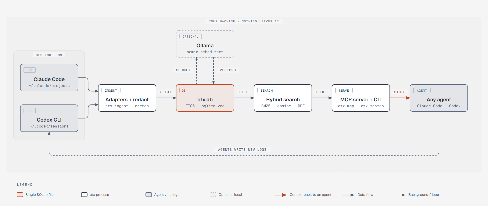

<div align="center">

# kaectx

### One local memory for every coding agent on your machine.

**Claude Code and Codex can search each other's past sessions. Nothing leaves the machine it runs on.**

[](https://github.com/danPoku/kaectx/releases/latest)
[](https://github.com/danPoku/kaectx/actions/workflows/test.yml)
[](go.mod)
[](#tools)
[](#install)
[](LICENSE)

[Quick start](#quick-start) · [How it works](#how-it-works) · [Remote development](#remote-and-cloud-development) · [MCP tools](#tools) · [Commands](#commands) · [Privacy](#privacy) · [Limitations](#limitations) · [Contributing](CONTRIBUTING.md)

```
go install -tags sqlite_fts5 github.com/danPoku/kaectx/cmd/ctx@latest
```

<sub>kaectx was called ctx until v0.1.3. The command, the database and the MCP server name are still <code>ctx</code>.</sub>

</div>

kaectx keeps one searchable copy of your coding-agent conversations, and lets any
agent search it.

I use Claude Code and Codex on the same projects. Each one writes its own
session logs, in its own format, and neither can see what the other worked out
yesterday. Neither is good at searching its own history either. kaectx reads the
logs those tools already write, puts them in a single SQLite file, and answers
queries from a command line and from an MCP server, so an agent can ask "have
we dealt with this before?" and get an answer from any agent's past sessions.

It is a single Go binary. Everything stays on your machine.

<picture>
  <source media="(prefers-color-scheme: dark)" srcset="docs/diagrams/architecture-dark.png">
  
</picture>

```
$ ctx search "how does the daemon embed new chunks in the background"
[claude-code] 2026-09-20T16:11:47.479Z  claude-code:91ae043d-130e-4d25-8db5-266fe79bbbd5
    User: run the embed worker from the daemon  Assistant: Tests pass, inc…
```

## Status

Early. The current tagged release is v0.2.0, which adds file-aware memory,
retrieval outcome tracking, opt-in risk-aware search, checkpoint and feedback
signals, `ctx doctor` and `ctx audit-secrets`. Linux (including Ubuntu under WSL2) is the
primary environment; native Windows is also supported and tested. Expect
breaking changes in the 0.x series, including to the database schema and the
MCP tool output. See
[Limitations](#limitations) before relying on it.

Articles written before v0.2.0 describe the v0.1.3 feature set. They are still
useful as snapshots of the original local-search release; pin `@v0.1.3` if you
want exactly what those articles show.

## What it does

- Reads Claude Code and Codex CLI session logs and stores them in
  `~/.ctx/ctx.db`.
- Splits each session into retrieval units: one user turn plus the assistant's
  reply, with tool noise trimmed.
- Searches them by keyword (SQLite FTS5) and, if you run a local embedding
  model, by meaning too. The two rankings are combined with reciprocal rank
  fusion.
- Groups sessions into projects by the normalised git remote of their working
  directory, so the same repository checked out in two places is one project.
- Records the git commit range a session ran against, resolved from the log's
  own timestamps, when its working directory is a git checkout.
- Explains a file from memory: which sessions touched it, what actions they
  took, and where to open the relevant exchange.
- Serves the history over MCP, so Claude Code, Codex, or any MCP client can
  search it, page through a session, and save notes.
- Redacts API keys and similar secrets before anything is written to disk,
  and can re-scan the stored history for anything the rules would now catch.
- Records which search results agents opened and whether they helped, and can
  use those outcomes to rerank later searches (opt-in).
- Tells agents when a session has grown long enough to warrant a handoff.
- Can run as a daemon that ingests sessions as they are written.

## Requirements

- Go 1.27 or newer, and a C compiler (the SQLite driver and the vendored
  sqlite-vec extension are built with cgo).
- The `sqlite_fts5` build tag. Every build and test command below includes it.
- Optional, for semantic search: [Ollama](https://ollama.com) with the
  `nomic-embed-text` model. Without it ctx falls back to keyword search and
  says so.

## Install

```
go install -tags sqlite_fts5 github.com/danPoku/kaectx/cmd/ctx@latest
```

`@latest` follows the newest tagged release. To pin one, use `@v0.2.0`. Running
`go version -m "$(command -v ctx)"` shows which version you have installed.

The repository and Go module were renamed from `ctx` to `kaectx` in v0.1.3. The
old path `github.com/danPoku/ctx` only resolves up to v0.1.2, so
`go install github.com/danPoku/ctx/...@latest` fails with a "module declares its
path as" error. Use the `kaectx` path above. The binary, `~/.ctx/ctx.db` and the
MCP server name are still `ctx`, so existing installs keep their data.

Or from a clone:

```
git clone https://github.com/danPoku/kaectx
cd kaectx
go install -tags sqlite_fts5 ./cmd/ctx
```

Either puts `ctx` in `$(go env GOPATH)/bin`. Make sure that directory is on your
`PATH`.

### Windows

Windows is fully supported, but SQLite and sqlite-vec require cgo and a
MinGW-w64 compiler. From a clone, the checked-in installer discovers an MSYS2
UCRT64 or MinGW64 compiler, optionally runs the native test gate, creates a
timestamped backup of the existing executable, and installs `ctx.exe` into the
Go bin directory:

```powershell
winget install MSYS2.MSYS2
C:\msys64\usr\bin\bash.exe -lc "pacman -S --needed --noconfirm mingw-w64-ucrt-x86_64-gcc"

git clone https://github.com/danPoku/kaectx
cd kaectx
.\scripts\install-windows.ps1 -RunTests
```

If an agent already has `ctx mcp` open, close that session first or add
`-StopRunningCtx`; Windows does not replace a running executable. Native
Windows stores its catalogue at `%USERPROFILE%\.ctx\ctx.db` and reads the
Windows-native Claude Code and Codex logs. It is independent of a WSL
installation and its `/home/<user>/.ctx/ctx.db`.

### macOS

macOS is expected to work on Apple Silicon and Intel, but it has not been built
or tested there yet. Nothing in the code is Linux-specific: session logs are
found under `~/.claude/projects` and `~/.codex/sessions` via the user's home
directory, and the database is `~/.ctx/ctx.db`. The likely snag is cgo, which
needs Apple's command-line compiler tools:

```
xcode-select --install
go install -tags sqlite_fts5 github.com/danPoku/kaectx/cmd/ctx@latest
```

For semantic search:

```
brew install ollama
ollama pull nomic-embed-text
ctx embed
```

If you try it, please open an issue with the result, good or bad.

## Quick start

```
ctx init                          # creates ~/.ctx and the database
ctx ingest                        # reads ~/.claude/projects and ~/.codex/sessions
ollama pull nomic-embed-text      # optional, enables semantic search
ctx embed                         # embeds chunks that don't have vectors yet
ctx search "refresh token race"   # searches the project you are standing in
ctx explain internal/auth.go      # shows past sessions that touched a file
```

`ctx search` is scoped to the project that contains your current directory. Use
`--agent claude-code` or `--agent codex` to restrict results to one agent,
`--limit N` to change how many come back, and `--since`/`--until` to search one
period (`--since 2026-09-28 --until 2026-10-04`; a date as `--until` includes
that whole day, dates are UTC). Equally good matches are listed newest first.
If some session logs haven't been ingested yet, it says so on stderr.

After upgrading from an older version, run these once (add `--dry-run` to see
what they would do first). Both read only what is already in the database, are
safe to repeat, and run in a single transaction:

- `ctx repair touches` rebuilds file records for Codex `apply_patch` calls
  ingested before ctx could read them, from the patch text already stored.
- `ctx repair messages` re-reads user messages from their stored raw lines.
  Older versions filed harness-injected text (task notifications, IDE context,
  Codex environment snapshots, AGENTS.md) as if the person had typed it, kept
  only the first block of a multi-part prompt, and left Codex sessions
  untitled. This reclassifies those messages, rebuilds the affected sessions'
  chunks (re-embedded by `ctx daemon` or `ctx embed`), and titles sessions
  from their first typed prompt.
- `ctx repair git` recomputes each session's git commit span from its own
  timestamps and rewrites older working-directory-relative file paths to be
  repo-root-relative. Rows whose directory no longer exists are retried on the
  next run.

`ctx explain <path>` is also project-scoped. The path is project-relative, such
as `internal/store/store.go`.

## Running it continuously

`ctx daemon` watches both session directories, ingests changes as they happen,
does a full rescan every five minutes in case a filesystem event was missed,
and embeds new chunks every 30 seconds if Ollama is reachable. If Ollama is
down it logs the error once and keeps ingesting.

Without the daemon, `ctx mcp` closes most of the gap itself: it catches up on
unread logs in the background when an agent starts it, and again when a search
finds logs it hasn't read. `search_context` and `recent_sessions` report this
in an `index` field, with a `warning` while logs are still unread, so an agent
can say "ctx is behind" instead of "nothing happened". A lock file
(`~/.ctx/ingest.lock`) keeps several MCP servers from catching up at once. The
daemon is still the way to keep the index current between sessions.

As a systemd user service:

```
# ~/.config/systemd/user/ctx-daemon.service
[Unit]
Description=ctx daemon

[Service]
ExecStart=%h/go/bin/ctx daemon
Restart=always
RestartSec=5

[Install]
WantedBy=default.target
```

```
systemctl --user enable --now ctx-daemon.service
```

After reinstalling the binary, run `systemctl --user restart ctx-daemon.service`
so the service picks it up. On WSL, user services stop when the WSL VM shuts
down and start again with your next session; anything written while it was off
is picked up by the next scan.

Daemon flags: `--embed-interval` (set to `0` to turn embedding off),
`--embed-batch`, `--ollama-url`, `--model`, `--fallback-interval`, `--debounce`.

## Remote and cloud development

If your agents run on a VPS, a remote dev box you reach over SSH, or a
Codespace, install ctx on that machine too. It works the same way there: it
reads the session logs of the agents running on that machine, keeps the
catalogue in that machine's `~/.ctx/ctx.db`, and the agents start `ctx mcp`
there. Transcripts stay on the server you control, and they never pass
through a third-party service.

Run Ollama on the same machine for semantic search. `ctx search` and
`ctx mcp` expect it on `localhost:11434`. Without it, search is keyword-only.

ctx is not a shared or network service. `ctx mcp` speaks MCP over stdio to
the agent that started it, and has no port and no authentication. Each machine
keeps its own catalogue, so sessions on your laptop and on your server are
searched separately. Projects are identified by their git remote, not their
path, so the same repository is recognised as one project on each machine.

## Connecting agents

`ctx mcp` speaks MCP over stdio. The agent starts it, and the server treats the
directory it was started in as the project.

Claude Code:

```
claude mcp add --scope user ctx -- ctx mcp
```

Codex, in `~/.codex/config.toml`:

```toml
[mcp_servers.ctx]
command = "ctx"
args = ["mcp"]
```

`codex exec` runs without a person to click "approve", so a tool call to ctx is
refused unless you also add `default_tools_approval_mode = "approve"` under that
same table. Interactive Codex asks instead.

Agents that were already running keep the old `ctx mcp` process until you start
a new chat.

### Tools

| Tool | What it does |
| --- | --- |
| `search_context` | Keyword plus semantic search over past sessions in this project, across all agents. Returns snippets centred on the match, each with the time of the turn, the message range (`first_seq`, `last_seq`) of the exchange it came from, and a `next_step` holding the exact `get_chunk` call that opens it. The search's ID is `run_id`; `retrieval_run_id` carries the same value and is deprecated. `since`/`until` limit it to one period. |
| `get_chunk` | Reads one search hit in full, the user turn and the assistant's reply (about 1k tokens), by `chunk_id`. Pass the search's `run_id` and the hit's `rank` together to record the exact result as opened; passing only one of them is an error. With `chunk_id` alone, the open is attributed to the latest search in the past day that returned the chunk and flagged `open_inferred`. When an open is recorded, `next_step` holds the `record_retrieval_outcome` call that labels it. |
| `get_session` | Reads a session's messages in order. Conversation text only unless `include_tools` is set; capped by total characters (`max_chars`, default 20000) and by message length, with `next_from_seq` for paging. |
| `recent_sessions` | Lists recent sessions, newest first; `since`/`until` list the sessions active in a period. |
| `sessions_touching` | Sessions that read or edited a given file. |
| `explain_file` | Builds a compact briefing for a file: sessions that touched it, actions, known git commit span, and chunk ids to open for the reasoning behind the work. |
| `save_note` | Records a decision, gotcha, convention, todo, or fact. |
| `search_notes` | Searches saved notes. |
| `record_retrieval_outcome` | Labels retrieved evidence as helpful, unhelpful, stale, incorrect or superseded. Pass the exact search run ID and rank returned by `search_context` or `get_chunk`. |
| `checkpoint_status` | Assesses the latest session's message count, elapsed span and file breadth. When a threshold is reached, the agent is instructed to offer a durable handoff and a fresh session; ctx never switches or ends the session automatically. Pass `session_id` to assess a specific session. |
| `feedback_status` | Returns a bounded inbox of checkpoint decisions and opened retrievals that still need an explicit outcome. It identifies missing feedback; it does not guess whether context was helpful. |
| `record_checkpoint_outcome` | Records whether the user started a new session, saved a handoff, continued, or dismissed a checkpoint recommendation. |

Search returns snippets on purpose. An agent that wants the full exchange calls
`get_chunk` with the hit's `chunk_id`, or `get_session` with the session id and
the hit's `first_seq` and `last_seq`.

Opening a search hit is recorded separately from its outcome. An open means the
agent inspected the evidence; it does not mean the evidence was correct or
useful. Once the agent knows whether the context influenced its answer or work,
it calls `record_retrieval_outcome` with that search run ID and rank. From migration
013 on, every open is kept as its own row (`retrieval_open_events`). Opens
from before it are represented by one row per result, marked `backfilled`,
even when that result had been opened several times. `ctx doctor` reports the
seven-day funnel from opened results to explicit labels, making missing feedback
visible instead of silently leaving risk-aware retrieval neutral.

Agents often read a hit with `get_chunk(chunk_id)` and nothing else. ctx then
attributes the open to the latest MCP search in the past day that returned that
chunk. If an earlier search returned the same chunk within five minutes of that
one, ctx records nothing, because the read could follow either. Even outside
that gap the guess can name the wrong search, so inferred opens are counted
separately (`inferred_open_count`), `feedback_status` asks about them at medium
rather than high confidence, and `ctx doctor` shows exact and inferred opens
apart.

### Checkpoint signals

Ctx asks connected agents to call `checkpoint_status` at natural milestones and
when a session becomes long or repetitive. The tool recommends a checkpoint at
400 messages, a four-hour session span, or 25 changed files. It strengthens the
recommendation when two signals fire, or when a session reaches 800 messages,
eight hours, or 40 files.

The signal is advisory. The agent should explain why it fired and offer three
choices: save a handoff and continue in a new session, save without switching,
or dismiss until the next milestone. A handoff should preserve the objective,
decisions, changed files, verification results, open risks and exact next action.
If the live session log has not been ingested yet, the result includes the same
`index.warning` used by search and starts a background catch-up; the agent should
retry after the warning clears before treating a healthy result as final.

### Feedback observer

At natural milestones, connected agents call `feedback_status`. Its inbox is
derived from activity CTX already records: checkpoint recommendations without a
decision and opened retrieval results without an outcome. Each nudge carries its
source and confidence plus the exact session or retrieval run/rank needed to
resolve it. This avoids a separate always-running helper and works with stdio MCP
clients, which cannot receive unsolicited prompts reliably.

A label is anchored to the first message of the exchange it judged, and counts
toward whichever chunk contains that message today. Labels therefore survive
`ctx repair messages` rebuilding chunks with new bounds. When chunks merge, the
merged chunk carries every label anchored inside it. When a chunk splits, its
labels stay with the part that holds the original question.

The observer deliberately records no inferred helpful/unhelpful label. An open
only proves that evidence was inspected, while a missing checkpoint decision
only proves that CTX has not recorded the choice. Explicit outcome tools remain
the boundary before evidence can influence reliability or retrieval policy.

### Getting agents to use `get_chunk`

Agents do not reliably pick `get_chunk` from its tool description alone. In a
small test, an agent told only to "use `search_context`, and `get_session` if
you need more detail" went straight to `get_session` every time. Naming the path
explicitly cut its token use by about a fifth and its calls from 18 to 16. Add
something like this to your `CLAUDE.md` or `AGENTS.md`:

```
To recall earlier work in this project, use the ctx MCP tools: call
search_context first, then get_chunk with a hit's chunk_id to read the matching
exchange. Use get_session only if the chunk is not enough, and pass the hit's
first_seq and last_seq rather than paging from the start.
```

## Commands

| Command | |
| --- | --- |
| `ctx init` | Create `~/.ctx` and the database. Other commands do this too if needed. |
| `ctx ingest [--path FILE] [--agent A]` | One-shot ingest of the default directories, or of a single file. |
| `ctx embed [--batch N]` | Embed pending chunks through Ollama. |
| `ctx search <query> [--agent A] [--limit N] [--since D] [--until D] [--risk-aware]` | Search the current project. `--risk-aware` reranks using recorded retrieval outcomes. |
| `ctx explain <path> [--limit N]` | Show sessions, actions and git span for a project-relative file. |
| `ctx repair git\|touches\|messages [--dry-run]` | Bring data ingested by older versions up to date (see [Quick start](#quick-start)). |
| `ctx project list` | Show projects, their remotes, session counts and known paths. |
| `ctx project merge <from> <into>` | Fold one project into another. |
| `ctx audit-secrets` | Re-scan stored text with the current redaction rules and report rows and rule names (never the matched text). Exits non-zero on findings. Changes nothing. |
| `ctx doctor` | Report the current project's sessions, embedding backlog, retrievals and outcomes, plus database-wide source, ingest-error and unassigned-chunk counts. |
| `ctx mcp` | Serve MCP over stdio. Catches up on unread session logs in the background. |
| `ctx daemon` | Ingest and embed continuously. |

`ctx project merge` exists because a session whose working directory has since
been deleted or moved can no longer have its git remote looked up, so it lands
in a project of its own. Merging moves the sessions, paths, notes and file
touches, refuses to merge two projects that both have a remote, and queues the
moved chunks for re-embedding.

## How it works

**Ingest.** Each agent has an adapter that turns its log lines into a common
shape. For every log file ctx records how many bytes it has read and a hash of
the part it has already seen. Running ingest twice never duplicates a message,
a file that only grows is read from where it left off, and a file whose earlier
bytes changed is read again from the start with the old rows replaced. A line
that can't be parsed is recorded in `sources.last_error` and skipped; it never
stops the rest of the file.

**Chunks.** A chunk is one user turn and the assistant's reply. A turn is
indexed when the next user message arrives. The last turn of a session is
indexed once it ends in assistant text; bookkeeping events written after the
reply are ignored, and a turn that ends in a tool call is left until it
finishes.

**Search.** Keyword search is BM25 over an FTS5 index. Semantic search is a
cosine nearest-neighbour lookup in a sqlite-vec table, 768 dimensions. Results
from the two are merged by reciprocal rank fusion (k = 60). Vector neighbours
farther than a cosine distance of 0.50 are discarded, because the nearest
neighbour of an unrelated query is still "nearest". Keyword hits are kept
whatever their vector distance. If Ollama isn't reachable or nothing has been
embedded yet, search runs keyword-only and reports that it did.

**Projects.** The current directory is matched to a known project by longest
path prefix. A new directory inside a git repository with an `origin` remote
takes that remote, normalised to `host/owner/repo`, as its identity.

**Storage.** SQLite in WAL mode with strict tables. The schema is in
`migrations/`. The vector table is optional: if the extension fails to load,
everything else keeps working. The queries are in `queries/retrieval.sql`.

## Privacy

kaectx only makes network requests to the Ollama URL you configure, which defaults
to `localhost`. Transcripts and embeddings never leave the machine.

Session logs contain whatever your agents saw, including the output of commands
they ran. Before storing a message, ctx redacts:

- well-known token formats (AWS access keys, GitHub, Slack, Google, Stripe and
  OpenAI/Anthropic-style keys, JWTs, `Bearer` tokens, PEM private keys),
- the value in `NAME=value` lines that look like `.env` entries,
- long tokens that mix letters and digits and have high entropy.

The original log line is kept in the `raw` column, redacted the same way.

This is pattern matching. It over-redacts on purpose (a UUID or commit hash can
be blanked out), and it will miss a secret that doesn't look like any of the
above. Treat `~/.ctx/ctx.db` as sensitive and don't share the file. ctx creates
`~/.ctx` with mode `0700` and tightens it if it finds it looser; leave it that
way.

## Limitations

- Only Claude Code and Codex CLI are supported. Adapters for other agents don't
  exist yet. Ingest has been checked against logs from Claude Code 2.1.278 and
  codex-cli 0.153.0. These formats are undocumented and change without notice,
  so a new version can break an adapter.
- kaectx reads logs from the environment where it runs. A native Windows
  process reads Windows agent logs and `%USERPROFILE%\.ctx\ctx.db`; a Linux or
  WSL process reads Linux agent logs and `~/.ctx/ctx.db`. The catalogues are
  separate unless deliberately migrated.
- File-touch tracking (`sessions_touching`, `explain_file`, `ctx explain`) covers
  Claude Code's Read, Edit, MultiEdit and Write tools and Codex's `apply_patch`.
  Other Codex tool calls and edits made through a shell command are not
  recorded. Paths are stored relative to the git repository root, so a session
  started in a subdirectory and one started at the root agree on the file's name.
  Outside a git checkout they are relative to the session's working directory.
- Git commit ranges are best effort, and `ctx explain` says how far to trust
  each one. Commits read from the session's own branch are shown plainly.
  Codex logs no branch, and a deleted branch is gone, so those spans are read
  from the current HEAD's history and marked *approximate*. A span kept from an
  older version whose repository has since disappeared is marked *unverified*.
  The MCP `explain_file` result carries the same information as `commit_source`
  and `commit_approximate`.
  A span is the newest commit on the session's branch (or HEAD, if that branch
  is unknown or gone) at the time of the first and last log lines, read from the
  checkout's first-parent history, so old sessions get the commit they actually
  started from. If the logged working
  directory is not a git checkout, or has no commit that old, the fields stay
  empty.
- The 0.50 distance cutoff was measured on about 60 chunks with
  `nomic-embed-text`. Expect to revisit it with a larger history or a different
  model.
- If a log file is rewritten so that it no longer mentions a session, that
  session's old rows stay in the database.
- There are no session summaries. The `summary` column exists and is unused.
- Redaction is best effort, as described above.
- macOS is untested (see [macOS](#macos)), and there are no prebuilt binaries
  yet, so installing needs Go and a C compiler.

## Development

Branches, pull requests and releases are covered in
[CONTRIBUTING.md](CONTRIBUTING.md). After cloning, enable the push guard once:
`git config core.hooksPath .githooks`.

Linux is the primary development environment:

```
go vet -tags sqlite_fts5 ./...
go test -tags sqlite_fts5 ./...
```

For native Windows development, install the MSYS2 UCRT64 compiler once and use
the installer to run the same test/vet gate and replace the local executable:

```powershell
.\scripts\install-windows.ps1 -RunTests -StopRunningCtx
```

Linux and Windows run as separate CI jobs. `TestOllamaClientLive` is excluded
from the deterministic default suite; set `CTX_LIVE_OLLAMA=1` to run it against
a real Ollama with `nomic-embed-text` pulled.

Layout:

```
cmd/ctx/             the command line
internal/store/      database open, migrations, project resolution and merge
internal/ingest/     the ingest loop and chunker, plus claudecode/ and codex/ adapters
internal/redact/     secret redaction
internal/embed/      Ollama client and the embedding worker
internal/search/     keyword and hybrid queries
internal/mcpserver/  the MCP tools
internal/daemon/     filesystem watching
internal/vecext/     vendored sqlite-vec and its cgo registration
migrations/          SQL schema
queries/             named SQL queries
```

Each adapter has fixture files in its `testdata/` directory, taken from real
sessions. When a log format changes, capture a real sample and add it there
before changing the adapter.

`CLAUDE.md` is the project brief I give to the coding agents that work on this
repository. It records decisions that are already made, which is useful to
human contributors too.

## License

Copyright 2026 Dan Gyinaye Poku (dan.gyinaye@gmail.com)

Licensed under the Apache License, Version 2.0. See [LICENSE](LICENSE) and
[NOTICE](NOTICE). Some third-party code is vendored under `internal/vecext/`;
NOTICE lists it.
